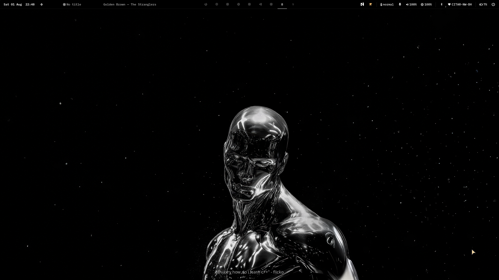
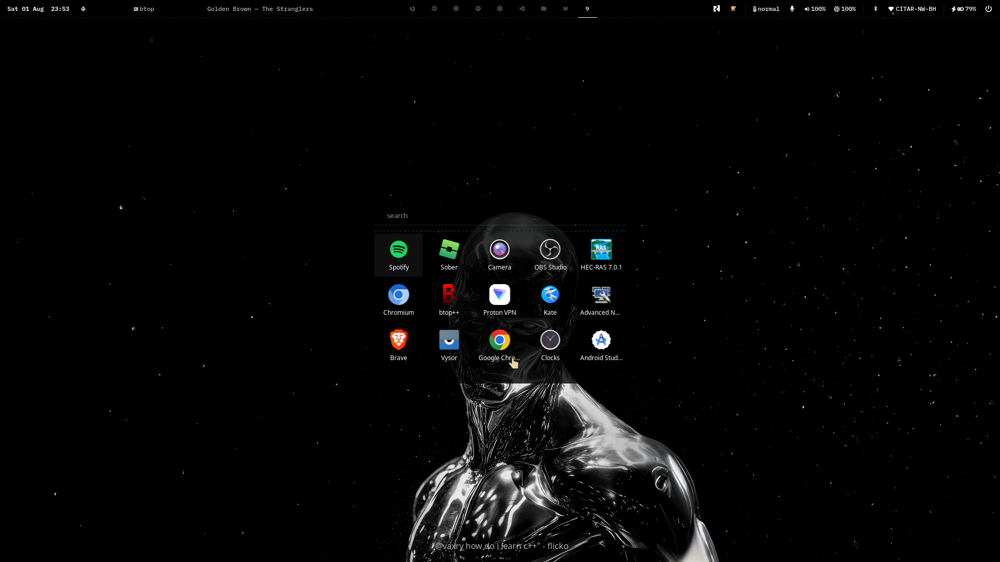
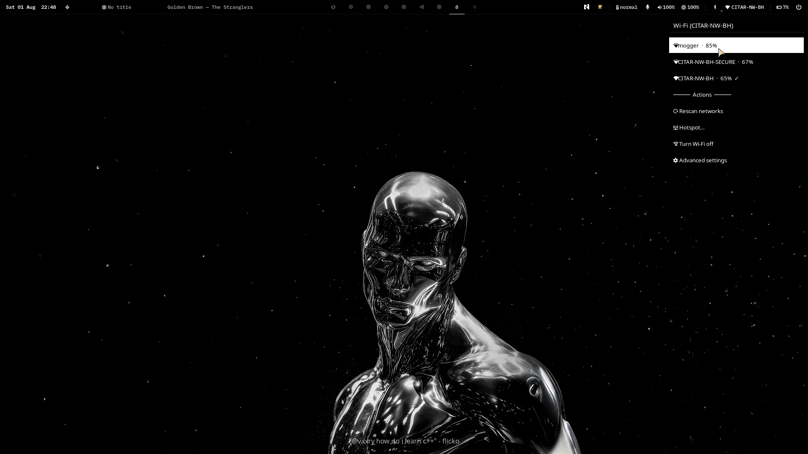
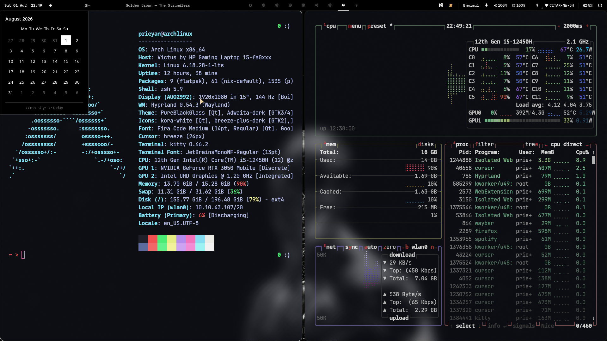
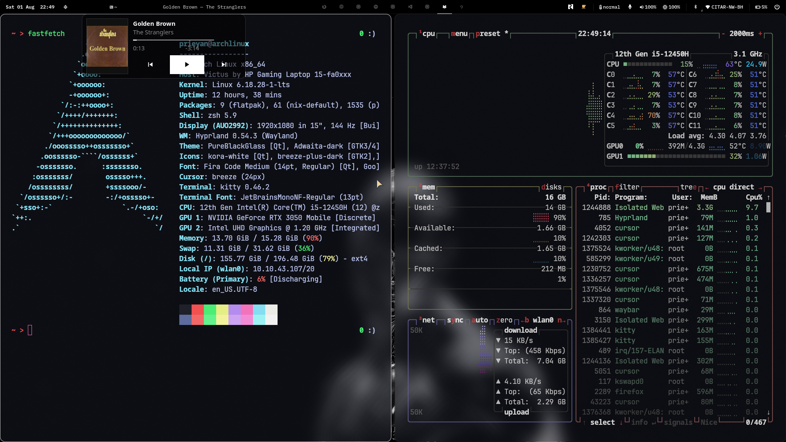

<div align="center">

# VerumDot

**Truth in black. Nothing else.**

*A pure-black **Hyprland rice** for Arch Linux — ink-void panels, frosted glass, white type.
No accent rainbow. No noise. Just signal.*

<br/>

[](https://github.com/PRIEYAN/VerumDot/stargazers)
[](LICENSE)
[](https://hyprland.org)
[](https://archlinux.org)
[](CONTRIBUTING.md)



<br/>

`Hyprland` · `Waybar` · `Rofi` · `Kitty` · `hyprlock` · `mako` · `PureBlackGlass`

**One command installs the whole desktop.**

```bash
bash <(curl -fsSL https://github.com/PRIEYAN/VerumDot/raw/main/install.sh)
```

<sub>⭐ If VerumDot makes your desktop better, a star helps other people find it.</sub>

</div>

---

## Philosophy

VerumDot strips the desktop down to what actually matters: **readability, speed, and presence**.

Black is the canvas. White is the ink. Glass is the depth — wallpaper bleeding through translucent bars, menus, and windows so the machine feels like one surface instead of a stack of chrome boxes. Every dropdown, lock screen, and tile follows the same grammar: sharp edges of meaning, soft edges of light.

Portable by design. One command and VerumDot is yours — no username baked in, no scavenger hunt across `~/.config`.

---

## Gallery

<p align="center">
  
  <br/><sub>Desktop — Waybar, wallpaper, Spotify now-playing</sub>
</p>

<p align="center">
  
  <br/><sub>App launcher — Rofi grid over the glass desktop</sub>
</p>

<table>
  <tr>
    <td width="50%" align="center">
      <br/>
      <sub>Wi-Fi menu</sub>
    </td>
    <td width="50%" align="center">
      <br/>
      <sub>Calendar popup</sub>
    </td>
  </tr>
  <tr>
    <td colspan="2" align="center">
      <br/>
      <sub>Spotify widget · Kitty · btop — translucent tiling</sub>
    </td>
  </tr>
</table>

---

## Why VerumDot

Most rices hand you a color scheme. VerumDot hands you a finished laptop.

- 🖤 **Actually pure black** — `#000000`, not "very dark grey." Perfect on OLED, honest on IPS.
- 🧙 **An installer that asks first** — reads your distro, GPU, battery and monitors, then shows the full plan and waits for a yes. Backs up everything it touches.
- 🔀 **Swap your stack at install time** — pick your terminal, browser, file manager and editor; the wizard rewrites the keybinds for you.
- 🪟 **No username baked in** — every path resolves through `lib/core/paths.sh`. Clone it anywhere, as anyone.
- 🌡️ **Eye comfort mode** — one click for a 3000K warm tint, through the compositor (`hyprsunset`), so it actually sticks on Wayland.
- ⚡ **Three-way performance toggle** — `SUPER + P` cycles performance → battery → normal across the CPU governor.
- 🔆 **Shader brightness boost** — push the panel past 100% with a GLSL shader when the sun wins.
- 👆 **Gesture-driven** — 3-finger swipe for workspaces, 4-finger up for a hidden scratchpad workspace.
- 🔋 **Laptop-literate** — battery alerts at 20/15%, lid-close locks instead of suspending, NVIDIA suspend fix included.
- 🔕 **Do-not-disturb** — `SUPER + CTRL + N`, straight into mako.
- 🎵 **Spotify, glassed** — a translucent now-playing card in the bar and a live quickshell dropdown on click.
- 🎛️ **Control centre** — throw the pointer at the top-right corner and a frosted panel slides in: brightness and volume sliders, power mode, mic, stay-awake. The Wi-Fi and Bluetooth tiles toggle from their icon and open network/device lists in place.
- 🖼️ **Two wallpaper pickers** — one for the desktop, one for the lock screen, both Rofi.

---

## Overview

VerumDot is a complete Arch + Hyprland environment: dark glass UI, white typography, zero decorative clutter. One folder. One installer. Everything speaks the same language.

| Layer | What you get |
|-------|----------------|
| **Compositor** | Hyprland — blur, rounding, opacity, gestures, lid/suspend tuned |
| **Bar** | Waybar — clock, Spotify, workspaces, mic/vol/brightness, battery, power |
| **Menus** | Quickshell — app launcher, control centre (Wi-Fi, Bluetooth), Spotify card · Rofi — power, volume, brightness, calendar, wallpapers |
| **Notifications** | mako — with do-not-disturb and low-battery alerts |
| **Lock / idle** | hyprlock + hypridle |
| **Editor** | Neovim — VS Code layout: explorer rail, tabs, docked terminal, glass panes |
| **Theme** | PureBlackGlass (Kvantum) + matching GTK / Qt / portal |
| **Apps** | Kitty, hyprpaper, Firefox, Nautilus |

> **Note:** the `apps/eww` panels are legacy — Rofi versions replaced them. They ship for reference and are off by default.

---

## Quick start

**Requirements:** a working Arch Linux (or compatible derivative) installation,
a normal user with `sudo` access, `curl`, and an internet connection. Install your
GPU driver first. Run setup as your normal user, never with `sudo ./setup.sh`.
The desktop currently requires the standard `~/.config` location; a custom
`XDG_CONFIG_HOME` is rejected because the shipped desktop configs use that path.

Package installation runs a **full system upgrade** with `pacman -Syu` to keep
Quickshell and Qt compatible. Resolve any existing pacman conflicts first.

### One command, fresh machine

```bash
bash <(curl -fsSL https://github.com/PRIEYAN/VerumDot/raw/main/install.sh)
```

This clones `main` into `~/.local/share/VerumDot`, installs the selected packages,
and copies the desktop into `~/.config/hypr`. The source checkout stays separate
from the deployed configuration. An existing source directory is never deleted;
a dirty checkout, another branch, or a failed update stops the bootstrap.
Use the local source checkout for subsequent updates.

### From a clone

```bash
git clone https://github.com/PRIEYAN/VerumDot.git
cd VerumDot && ./setup.sh
```

### The installer

`setup.sh` opens an interactive wizard. It reads the machine first — distro, AUR
helper, GPU, battery, connected outputs, existing config — then asks what to do
with it. Arrow keys move, space toggles, enter confirms; every question has a
default, so holding enter is a valid answer.

| It asks | It does |
|---------|---------|
| Full / config-only / packages-only | scopes the run |
| Which package groups | audio, capture, network, power, theming, fonts, apps, AUR |
| Terminal · browser · file manager · editor | installs your picks and rewrites the binds in `hypr.conf` |
| Which output, which scale | writes the real `monitor =` line — no more editing `eDP-1` by hand |
| Wallpaper folder | creates it, seeds an image if empty, saves the choice and links both wallpapers under `assets/` |
| Theme · services · lid policy | PureBlackGlass, pipewire, lock-don't-suspend |

Then it prints the full plan and waits for a yes before touching anything.
Replaced config entries are backed up as `<path>.bak.<timestamp>-<pid>`;
theme links use `.prehypr` for the first backup. GTK/Qt settings are edited by key,
preserving unrelated keys. Setup logs to `~/.cache/verumdot-install-*.log`.
Package, copy, and Quickshell runtime failures stop with a nonzero exit status;
fix the reported error and rerun the same command. Dry runs and help do not
create logs or change files.

### Flags

```bash
./setup.sh              # interactive wizard
./setup.sh --auto       # zero questions, everything, sane defaults
./setup.sh --packages   # dependencies only
./setup.sh --config     # config + theme only
./setup.sh --dry-run    # print the plan, change nothing
./setup.sh --list-packages # current default repo/AUR package list
./setup.sh --no-aur     # skip AUR apps/themes, including Spotify and VS Code
./setup.sh --no-nvim    # do not bootstrap or modify a Neovim config
./setup.sh --no-services # do not enable or start system/user services
./setup.sh --no-lid     # leave the system lid policy alone
./setup.sh --no-theme   # skip GTK/Qt theme setup
./setup.sh --no-anim    # skip the intro animation
./setup.sh --help
```

Skip flags can be combined with `--auto`, `--config` or `--packages`.
`--packages` leaves desktop configuration and services alone. `--config` requires
Quickshell and Python to be installed already and still configures services/lid
policy unless those actions are skipped. Without a terminal, select an explicit
mode; the wizard will not silently accept defaults.

Flags pass through the bootstrap too (use `--list-packages` in the local clone):

```bash
bash <(curl -fsSL https://github.com/PRIEYAN/VerumDot/raw/main/install.sh) --auto
```

### After install

1. Drop wallpapers into `~/Pictures/Wallpapers/`
2. Log out, pick the **Hyprland** session, log back in
3. Reload anytime: `hyprctl reload`

When no output is detected, setup uses `monitor = ,preferred,auto,1` so a desktop
or another laptop is not tied to `eDP-1`. Adjust `~/.config/hypr/hypr.conf` if needed
(`hyprctl monitors` lists outputs). A changed lid policy takes effect after reboot;
setup does not restart logind in the middle of your session.

### Quickshell and dependencies

The launcher, control centre, Spotify card and keybind viewer live under
`~/.config/hypr/apps/quickshell/`. Setup repairs their `shared -> ../shared` imports,
links the named configs under `~/.config/quickshell/`, and checks the required Qt
and Quickshell modules with a short offscreen process before deploying anything.
The native networking service needs a current Quickshell build; the audited
version is [Quickshell 0.3.2](https://quickshell.org/docs/v0.3.2/types/Quickshell.Networking/Networking/).

The installer includes Python for privacy/keybind helpers, `socat` for live
Hyprland events, `libnotify`, the Qt QML/SVG/Wayland/image/multimedia packages,
`hyprpolkitagent`, and the networking/audio/power services used by the control
centre. Fonts include Inter and Nerd Fonts; sensor statistics use `lm_sensors`.
`qt5ct` and `kvantum-qt5` are repository packages, not AUR extras.
`./setup.sh --list-packages` is the authoritative default list; `packages.txt` is
an older reference and should not be piped into a package manager.

Setup also links Hypridle and Hyprlock configs into their standard search paths,
creates GTK and Qt settings on fresh homes, and seeds
`assets/current-wallpaper` and `assets/lock-wallpaper`. Existing valid wallpaper
choices are retained. The default overlay also installs Neovim, ripgrep, fd and
unzip; `--no-nvim` skips these overlay dependencies and deployment (selecting
Neovim as your editor still installs the editor itself). A fresh Neovim config
uses the LazyVim starter; its plugins download on first launch.
Legacy eww and the manually invoked AnyDesk helper are not part of the default
desktop. AnyDesk requires its own separately installed package.

If setup reports a module error, inspect the printed install log. Avoid mixing
an old Quickshell binary with newly upgraded Qt libraries. Reinstall matching
packages through `./setup.sh --packages`, then retry config deployment. To debug
a panel from inside a Hyprland session:

```bash
qs -p ~/.config/hypr/apps/quickshell/controlcenter --no-color
```

The splash screen is separate work: the version currently on `main` imports
`Quickshell.Core`, which is unavailable in Quickshell 0.3.2. This installer update
does not change splash QML or merge the splash-screen branch. That existing
splash error does not mean the four desktop panels are missing their modules.

### Safe preview and config repair

```bash
./setup.sh --auto --dry-run
./setup.sh --config --no-services --no-lid --no-nvim
```

The bootstrap's `--dry-run` prints only its fetch/handoff plan without cloning;
run the local `setup.sh --dry-run` to inspect the full dependency/config plan.

### Installer validation

The installer update was checked in Bubblewrap with a read-only host filesystem,
disposable home/runtime directories, and isolated network/process namespaces:
34 scenarios covered fresh deployment, reruns, in-place setup, backups, dry runs,
failed packages/services/copies/themes, lost QML symlinks, bootstrap branch/update
checks, the tar fallback, AUR-helper setup, and fresh/existing Neovim configs.
Package, sudo, download and service mutations were simulated; the Quickshell
module import check used the real installed runtime. All 90 existing library
checks and syntax checks for all 88 shell files passed. The 65 default repository
packages resolved against an empty installed-package database using the local
Arch repository metadata (599 packages including dependencies).

This is not a full package-download/install or GPU/Wayland login test on another
laptop. Wi-Fi, Bluetooth, audio devices and graphical panel interaction still
need a real session; the existing splash QML error is described above.

### Migrate

```bash
./setup.sh          # full
./setup.sh --config # if packages are already installed
```

Live config always lands at `~/.config/hypr`.

---

## Keybinds

### Launch

| Bind | Action |
|------|--------|
| `SUPER` + `Return` / `T` | Terminal (Kitty) |
| `SUPER` + `Space` / `R` | App launcher |
| `SUPER` + `W` | Browser (Firefox) |
| `SUPER` + `E` | Files (Nautilus) |
| `SUPER` + `C` | Editor (VS Code) |
| `SUPER` + `L` | Lock screen |
| `XF86PowerOff` | Power menu |

### Windows

| Bind | Action |
|------|--------|
| `SUPER` + `Q` | Kill window |
| `SUPER` + `F` | Fullscreen |
| `SUPER` + `Tab` / `Shift` + `Tab` | Focus next / previous |
| `SUPER` + drag `LMB` / `RMB` | Move / resize |

### Workspaces

| Bind | Action |
|------|--------|
| `SUPER` + `1`–`0` | Switch workspace |
| `SUPER` + `CTRL` + `SHIFT` + `1`–`0` | Move window to workspace |
| `SUPER` + `CTRL` + `←` / `→` | Previous / next workspace |
| `SUPER` + scroll | Cycle workspaces |
| `SUPER` + `CTRL` + `SHIFT` + `↑` / `↓` | Open / close hidden workspace |
| `SUPER` + `CTRL` + `SHIFT` + `R` | Reload Hyprland |

### System

| Bind | Action |
|------|--------|
| `SUPER` + `P` | Performance mode (performance → battery → normal) |
| `SUPER` + `SHIFT` + `W` | Wallpaper picker |
| `SUPER` + `CTRL` + `SHIFT` + `W` | Lock-screen wallpaper picker |
| `SUPER` + `N` | Dismiss notification |
| `SUPER` + `SHIFT` + `N` | Dismiss all |
| `SUPER` + `CTRL` + `N` | Toggle do-not-disturb |
| `Print` | Full screenshot |
| `SHIFT` + `Print` | Region screenshot |
| Brightness / volume keys | Adjust (volume boosts to 150%) |

### Editor (Neovim)

Applies inside Neovim once the overlay is deployed — see [`apps/nvim/`](apps/nvim/).

| Bind | Action |
|------|--------|
| `CTRL` + `SHIFT` + `` ` `` | Toggle the terminal dock (also `CTRL` + `` ` ``) |
| `CTRL` + `B` | Toggle the explorer rail |
| `SPACE` + `e` | Focus the explorer |
| `SPACE` + `tt` | Toggle the terminal dock |
| `Esc` `Esc` | Leave terminal mode |

### Gestures

| Gesture | Action |
|---------|--------|
| 3-finger swipe ←→ | Change workspace |
| 4-finger swipe ↑ | Open hidden workspace (from workspace 1) |
| 4-finger swipe ↓ | Close hidden workspace |

Screenshots → `~/Pictures/Screenshots` (+ clipboard).

---

## Tree

```
VerumDot/
├── install.sh            # one-command bootstrap (clone + setup)
├── setup.sh              # interactive installer
├── packages.txt          # historical reference; setup.sh --list-packages is current
├── hyprland.conf         # entry → ./hypr.conf
├── hypr.conf             # binds, blur, rules, gestures
├── shaders/              # GLSL brightness boost
├── screenshots/          # gallery assets
├── scripts/
│   ├── wallpaper.sh
│   ├── screenshot.sh
│   ├── battery-alert.sh
│   └── theme-install.sh
└── apps/
    ├── waybar/           # bar + module scripts
    ├── quickshell/       # launcher, control centre, Spotify, keybinds
    ├── rofi/             # fallback launcher & menus
    ├── hyprlock/
    ├── hypridle/
    ├── kitty/
    ├── nvim/             # VS Code layout overlay (glass panes)
    ├── mako/
    ├── eww/              # legacy panels
    └── theme/            # PureBlackGlass
```

---

## Details

- **Wallpapers** — `~/Pictures/Wallpapers/`; desktop/lock images are linked as `assets/current-wallpaper` and `assets/lock-wallpaper`
- **Theme refresh** — `~/.config/hypr/scripts/theme-install.sh`
- **Neovim glass** — the panes are painted by `apps/nvim/lua/verum/palette.lua` and made see-through by `transparent_background_colors` in `apps/kitty/kitty.conf`; the two lists must match, or a pane goes opaque. `setup.sh --no-nvim` skips the overlay entirely
- **Glass Spotify** — window opacity rule in `hypr.conf`; quickshell dropdown via Waybar click
- **NVIDIA / lid** — comments in `hypr.conf` and `apps/hypridle/hypridle.conf`
- **Eye comfort** — needs `hyprsunset`; the toggle manages the daemon directly (see the note in `apps/waybar/scripts/eye-comfort-toggle.sh` for why not redshift)
- **Performance mode** — needs `cpupower` for governor switching; degrades quietly without it

---

## Contributing

Issues and PRs welcome — read [CONTRIBUTING.md](CONTRIBUTING.md) first. The
short version: pure black, white type, no accent colors, portable paths, and
new menus go through Rofi.

Running VerumDot? Post a screenshot in
[Discussions](https://github.com/PRIEYAN/VerumDot/discussions) — I want to see
what you did with it.

## License

[MIT](LICENSE) — take it, fork it, make it yours.

---

<div align="center">

**VerumDot** — where the desktop stops arguing with itself.

<sub>If this saved you a weekend of config editing, leave a ⭐</sub>

</div>
